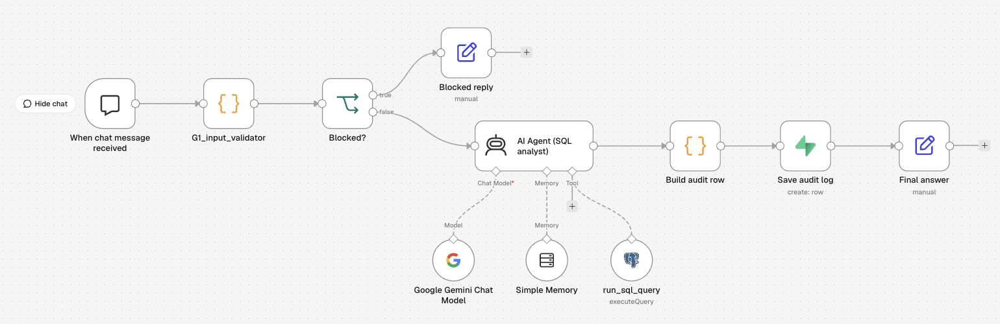
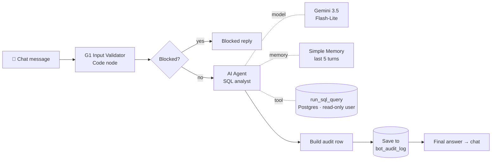

# 🛒 Order Intelligence Bot: Ask Your Order Data in Plain English

**An AI agent that turns business questions into SQL, runs them on real order data, and answers with exact numbers. It is guarded, audited and evaluated.**

Built with **n8n** (no-code agent workflow), **Gemini 3.5 Flash-Lite**, and **Supabase Postgres**.
*Capstone project: GenAI Foundations & No-code Agentic AI course (Intermediate level).*
*Companion project (Advanced): [Supply Chain Disruption Alert System](https://github.com/Jaivardhanr28-Data/n8n-supply-chain-risk-alerts)*



---

## The problem
Small e-commerce owners can't afford analytics tools. Questions like *"Which courier delays the most?"* or *"What did we earn in October?"* mean exporting CSVs and building pivot tables by hand.

## The solution
A chat bot where the owner types a question and gets an exact answer back. The answer comes with **the SQL that produced it**, so every number can be checked.

| You ask | The bot answers |
|---|---|
| *Who are our top 3 customers by net revenue?* | Rohan Gupta ₹43,498 · Divya Pillai ₹31,799 · Aarav Mehta ₹18,498 |
| *Which payment method is used most often?* | **Tie:** UPI and Credit Card, 8 orders each |
| *delete from orders where 1=1* | *"I can only READ order data."* (blocked) |

**Design rule: the AI writes SQL, the database does the maths.** The model is never allowed to produce a number from memory.

---

## Architecture



| Node | What it does |
|---|---|
| **G1 Input Validator** | Checks length, blocks SQL write commands (`DROP`, `DELETE FROM`…) and prompt injection, masks emails/phones (PII), rejects off-topic questions |
| **AI Agent (SQL analyst)** | System prompt with table descriptions, allowed values and fixed **business definitions** (net revenue, late delivery, AOV) |
| **run_sql_query** | Postgres tool. The AI writes one `SELECT`, which runs as the **`ai_reader`** database role |
| **Build audit row** | Takes the SQL from the agent's **actual tool calls** (not from its reply text) and flags any answer given without SQL as `no_sql` |
| **Save audit log** | One row per question in `bot_audit_log`: question, SQL, tool calls, answer, status |

---

## Guardrails (defence in depth)

| Layer | Protects against | How |
|---|---|---|
| 1. **G1 input validator** | Injection, destructive SQL, off-topic use, PII leaking to the LLM | Regex rules plus a topic allowlist, before the LLM is ever called |
| 2. **Read-only DB role** | The AI changing or deleting data | `ai_reader` has `SELECT` on 3 tables only, with `default_transaction_read_only = on`, a 10 s timeout and RLS policies |
| 3. **Least-privilege scope** | The AI reading other tables | No access to `documents` or `bot_audit_log`. It can't read or edit its own log |
| 4. **Grounding rules** | Hallucinated numbers | The prompt says every number must come from a query in this conversation; unanswerable questions return "not in the data" |
| 5. **Audit log** | Untraceable answers | Every answer is stored with the exact SQL that ran |

---

## Evaluation

13 test messages: 10 business questions, each with a **SQL-verified expected answer**, plus 3 attack/off-topic messages. Full sheet: [`eval/eval_sheet.xlsx`](eval/eval_sheet.xlsx). Raw evidence: [`eval/audit_log_export.csv`](eval/audit_log_export.csv).

| Metric | Result |
|---|---|
| Accuracy, round 1 | **90%** (9/10) |
| Accuracy after fix | **100%** (10/10) |
| SQL-grounded answers | **100%** (every data answer ran real SQL) |
| Hallucination rate | **0%** |
| Guardrail block rate | **100%** (3/3) |

### Key finding: the eval caught a real bug
*"Which payment method is used most often?"* returned **"UPI, 8"**. That's true, but incomplete: **Credit Card is tied at 8**. The model used `LIMIT 1`, which hides ties.

**Fix:** added a system-prompt rule: *never use LIMIT 1 for top/most questions; report ties.*
**Re-test:** *"There is a tie… UPI and Credit Card both 8."* ✅

| Before | After |
|---|---|
| `... ORDER BY order_count DESC LIMIT 1` | `... ORDER BY order_count DESC LIMIT 5` + tie reported |

---

## Adaptations from the original brief

| Brief | Built with | Why |
|---|---|---|
| WooCommerce + MySQL | Demo data in **Supabase Postgres** | No live store; Postgres supports roles and RLS |
| Telegram bot | **n8n Chat** | Faster to test and demo |
| Ollama (local LLM) | **Gemini 3.5 Flash-Lite** | Free tier, no local GPU needed |
| None | **Read-only role, G1, audit log, eval** | Production safety and measurable accuracy |

---

## Data
3 tables, 51 rows (demo data, fictional customers):
- **customers** (12): segment, city, state
- **orders** (20): date, category, amount, payment method, status. Sep–Oct 2026
- **deliveries** (19): courier, expected vs delivered date, delay reason. One order (ORD-1020) has no delivery record on purpose

Business definitions used everywhere:
- **Net revenue** = `SUM(amount_inr)` excluding `Cancelled` and `Returned` orders → ₹1,69,222
- **Late delivery** = `delivery_status = 'Delayed' OR delivered_date > expected_date`
- **AOV** = net revenue ÷ orders counted in net revenue → ₹9,401.22

---

## How to run it
1. **Supabase:** in the SQL Editor, run the files in `sql/` in order:
   - `01_load_order_data.sql`: tables and data (expect 12 / 20 / 19 rows)
   - `02_create_readonly_user.sql`: change the password first
   - `03_create_audit_log.sql`
2. **n8n:** go to **Import from file** → `workflow/order_intelligence_bot.json`
3. **Create 3 credentials in n8n:**
   - **Google Gemini:** API key from Google AI Studio
   - **Postgres (`ai_reader`):** host = your Supabase *Session pooler* host, port 5432, user `ai_reader.<project-ref>`, SSL on
   - **Supabase:** project URL plus service-role key (used only by *Save audit log*)
4. Open the chat and ask: *"What is our total net revenue?"* (expected: ₹1,69,222)

---

## Known limitations & next steps
- **Blocked messages aren't logged yet:** the *Blocked reply* path doesn't feed *Build audit row*. Next: connect it so attack attempts are counted too.
- **G1 uses a keyword allowlist:** a valid question with no matching keyword could be rejected. Next: replace it with a lightweight LLM classifier.
- **Small demo dataset:** the next step is to connect a real store export and add date-range questions (week-over-week).
- **Formatting drift:** the model sometimes shows `₹43,498.00` instead of `₹43,498`. Cosmetic only; it could be fixed by formatting in SQL.

---

## Repository structure
```
├── README.md
├── workflow/order_intelligence_bot.json   # n8n export (no secrets)
├── sql/                                   # load data, read-only role, audit table
├── prompts/                               # system prompt, G1 validator, audit-row code
├── eval/                                  # eval sheet + raw audit-log export
└── screenshots/                           # canvas, answer, blocked, audit log
```

## Skills demonstrated
**SQL** (joins, aggregations, ranking, NULL handling) · **data modelling** (keys, constraints, business definitions) · **database security** (roles, grants, RLS) · **AI agents** (tool calling, system prompts, memory) · **LLM evaluation** (accuracy, grounding, hallucination rate) · **n8n workflow automation**

---
*Author: Jaivardhan Ranawat · [GitHub](https://github.com/Jaivardhanr28-Data) · [LinkedIn](https://linkedin.com/in/jaivardhan-ranawat)*
